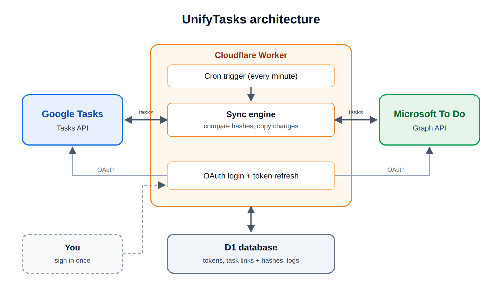

# UnifyTasks

UnifyTasks keeps Google Tasks and Microsoft To Do in sync, both ways. Add, edit, complete or delete a task in one app, and within a minute the other app has it too.

It runs on Cloudflare's free tier.



## How it works

Every minute, the app checks both Google Tasks and Microsoft To Do and copies any changes to the other side.

- If the same task is edited in both apps, the latest edit is kept.
- The app remembers each task after syncing, so it never copies its own changes back.
- Deleted tasks are removed from the other app after a one minute safety wait.
- Tasks with the same name are matched on the first run, so there are no duplicates.

Built with TypeScript, Cloudflare Workers, D1, the Google Tasks API and Microsoft Graph.

## Run your own copy

You'll need Node.js, a Cloudflare account, a Google account and a personal Microsoft account. Your copy runs on your accounts and syncs your tasks only.

1. Clone the repo and deploy once to get your Worker URL:
   ```
   git clone repo
   cd unifytasks/task-sync
   npm install
   npx wrangler login
   npx wrangler deploy
   ```

2. Google: in Google Cloud Console, enable the Google Tasks API, set up the consent screen with the tasks scope, and create a Web OAuth client with the redirect URI `https://YOUR_WORKER_URL/auth/google/callback`.

3. Microsoft: in the Azure portal, register an app for any Entra tenant plus personal accounts, with the redirect URI `https://YOUR_WORKER_URL/auth/microsoft/callback`. Add the `Tasks.ReadWrite` and `offline_access` permissions and create a client secret.

4. Create the database, put its ID in `wrangler.jsonc`, and create the tables:
   ```
   npx wrangler d1 create task-sync-db
   npx wrangler d1 execute task-sync-db --remote --file=./schema.sql
   ```

5. Add your keys. ADMIN_KEY is any random string you pick, it protects the admin pages.
   ```
   npx wrangler secret put GOOGLE_CLIENT_ID
   npx wrangler secret put GOOGLE_CLIENT_SECRET
   npx wrangler secret put MS_CLIENT_ID
   npx wrangler secret put MS_CLIENT_SECRET
   npx wrangler secret put ADMIN_KEY
   ```

6. Deploy again, then open these in your browser:
   - `/auth/google?key=ADMIN_KEY` to connect Google
   - `/auth/microsoft?key=ADMIN_KEY` to connect Microsoft
   - `/setup?key=ADMIN_KEY` to pair your default lists

Then, Check `/status` anytime to see when it last synced.

## Limitations

- takes a min to update
- no notifications